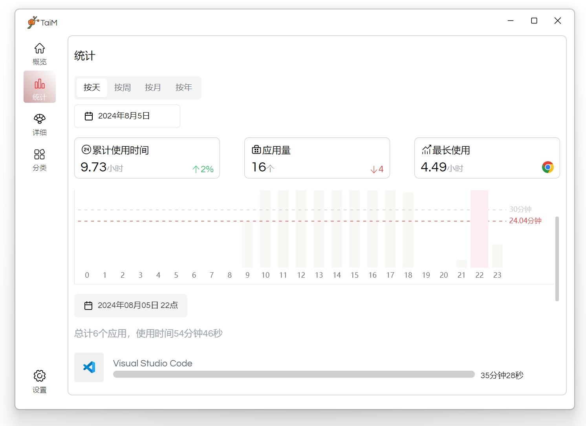

> [!WARNING]
> 目前还是开发阶段，只支持windows，功能还在完善中，欢迎提交issue。

## TaiM！

`windows` 的时间统计软件，记录和统计你每天使用软件的时间，帮助你更好的管理时间。




## 功能

- [x]  统计软件使用时间
- [x] 睡眠模式，五分钟与窗口不交互不进行统计
- [x] 开机自启动（Windows 安装版）
- [x] 自定义忽略软件（名称或完整路径）
- [ ] 监控网站使用时间
- [x] 图标缓存、按需加载图表模块、释放图表与事件监听（仍需长期内存测试）
- [ ] 多语言
- [ ] 添加流畅动画
- [x] 主题切换/随着系统自动切换
- [x] 设置统计时间范围（详情页）
- [x] 自定义分类、应用别名和历史明细
- [x] JSON 备份恢复 / CSV 导出
- [x] Windows 安装版更新检查、下载与重启安装、应用内更新日志

## 下载使用

前往 [GitHub Releases](https://github.com/badspider7/TaiM/releases) 下载 Windows x64 的 `TaiM-Windows-版本号-Setup.exe` 安装包。测试版尚未签名，Windows 可能提示未知发布者。安装版可在“设置 → 关于”检查更新。

发布由 [Release CI](https://github.com/badspider7/TaiM/actions/workflows/release.yml) 自动构建：推送与 `package.json` 一致的 `v版本号` 标签，检查通过后自动创建 Release 并上传安装包、blockmap、更新元数据和 SHA256 校验文件。带 beta 的版本自动标为预发布。

## 本地运行

需要 Windows x64、Node.js 20+ 和 pnpm。原生模块通常可下载预编译文件；如需本地编译，安装 Python 3 和 Visual Studio Build Tools 的“使用 C++ 的桌面开发”组件。

```sh
pnpm install
pnpm run rebuild
pnpm dev
```

`pnpm run rebuild` 为项目所用 Electron 准备 SQLite 原生模块，并复制到 `dist-native`。更换 Electron 或 CPU 架构后需要重新执行；不要复用其他机器的原生二进制文件。pnpm 如提示构建脚本被忽略，请允许 Electron、better-sqlite3、get-windows 的依赖构建。

```sh
pnpm lint       # 静态检查
pnpm build      # 类型检查及生产构建
pnpm test       # 先 build；使用独立临时数据库运行 Electron 集成测试
pnpm release:win # 生成 Windows 安装包（需另外验证安装与自启动）
```

更新行为、发布步骤与验证范围见 [自动更新说明](docs/updates.md)。

## 使用说明

- 关闭窗口后驻留托盘，托盘菜单可显示或退出；正常退出会保存未落盘记录。
- 设置 → 通用：自动保存主题、窗口大小和开机启动设置。开发模式不修改系统启动项。
- 设置 → 行为：设置 1–60 分钟空闲阈值、添加忽略应用；锁屏和休眠自动暂停。
- 分类：新增、重命名、删除分类并分配应用；删除分类后应用转为未分类。
- 详细：按日期范围查询、搜索、筛选分类，点击应用查看逐日记录并修改别名。
- 设置 → 数据：JSON 用于恢复全部统计及分类，CSV 用于分析。导入是替换操作，会校验文件、请求确认，并先备份当前 SQLite 数据库。通用设置与忽略规则不包含在 JSON 中。
- 概览每 15 秒和重新聚焦时刷新。正常运行每 15 秒落盘；意外断电或强制结束进程仍可能损失最近尚未保存的数据。

发布模式数据位于 Electron 的用户数据目录，可从“设置 → 数据 → 打开数据目录”访问；开发模式数据库为项目目录的 `sqlite3.db`。设置文件始终位于用户数据目录。

本轮变更、验证和后续项见 [项目检查记录](docs/project-audit.md)。旧版已写入的负数或错误日期无法准确反推，本轮不会自动改写这些历史记录；建议先备份原数据库。

 所有的数据都保存在本地，使用的`better-sqlite3`

 前端框架使用了`Vue3`、`Vite5`、`Tailwindcss`、`shadcn/vue`

 ## 鸣谢
 页面UI和逻辑的想法来源于 ---  [Tai](https://github.com/Planshit/Tai)

 监测当前活动页面使用的插件 --- [get-windows](https://github.com/sindresorhus/get-windows)

## 贡献
欢迎提交PR，或者提交issue。
