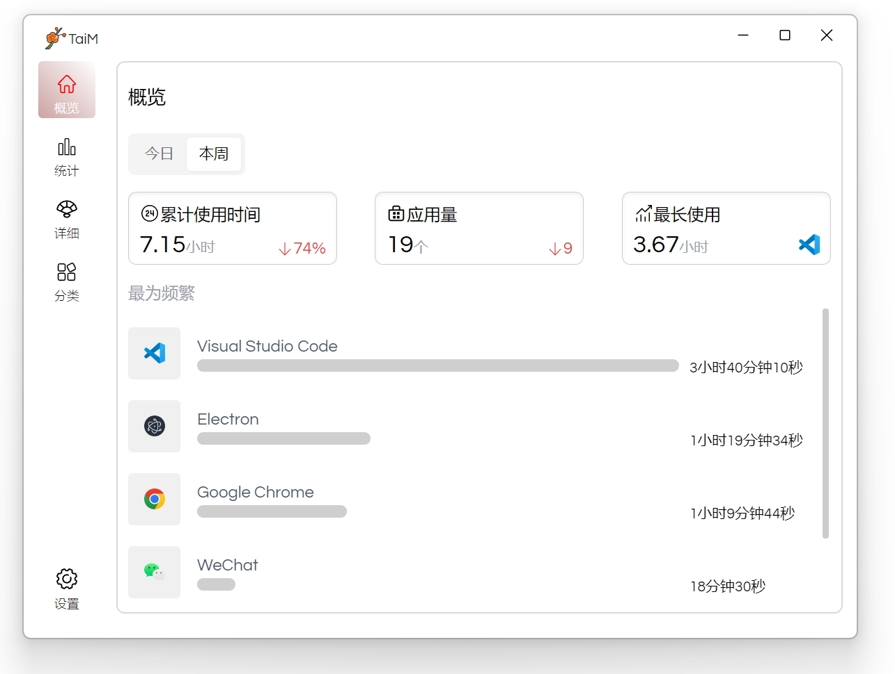
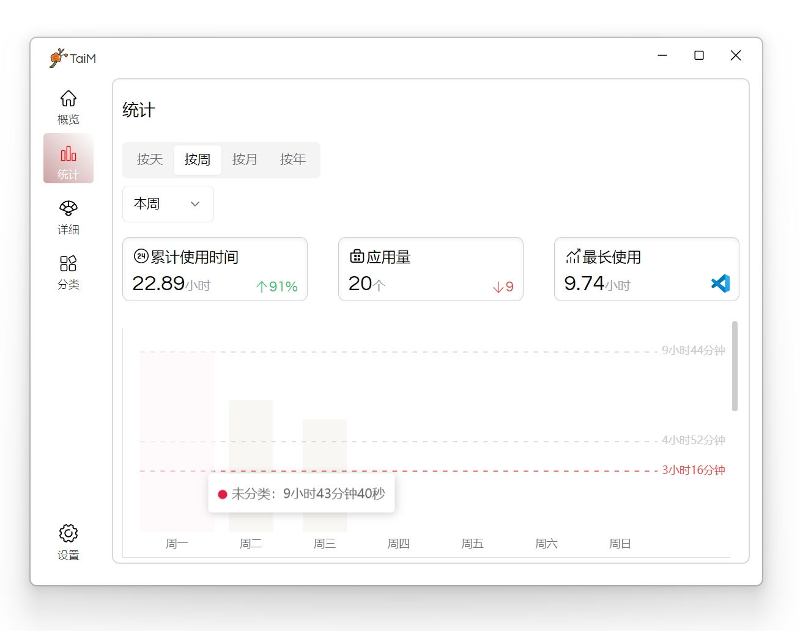

> [!WARNING]
> Windows x64 已作为主要平台验证；macOS Apple 芯片和 Linux x64 提供实验性构建，运行与安装尚未在真实设备上验证，欢迎提交 issue。

## TaiM！

桌面时间统计软件，记录和统计你每天使用软件的时间，帮助你更好地管理时间。





## 功能

- [x]  统计软件使用时间
- [x] 睡眠模式，五分钟与窗口不交互不进行统计
- [x] 开机自启动（Windows 安装版）
- [x] 自定义忽略软件（名称或完整路径）
- [x] 自动排除 TaiM 自身，并清理旧版误计的自身记录
- [x] Chrome / Edge 前台网站使用时间（需加载本地扩展）
- [x] 图标缓存、按需加载图表模块、释放图表与事件监听（仍需长期内存测试）
- [ ] 多语言
- [ ] 添加流畅动画
- [x] 主题切换/随着系统自动切换
- [x] 设置统计时间范围（详情页）
- [x] 自定义分类、应用别名和历史明细
- [x] JSON 备份恢复 / CSV 导出
- [x] Windows 安装版自动检查并下载更新，下载完成后提示重启安装，应用内显示最新版本日志

## 下载使用

前往 [GitHub Releases](https://github.com/badspider7/TaiM/releases) 下载 Windows x64 的 `TaiM-Windows-版本号-Setup.exe`、macOS Apple 芯片的 `.dmg` 或 Linux x64 的 `.AppImage`。macOS/Linux 构建目前为实验性版本；Linux 前台统计依赖 X11、`xprop` 和 `xwininfo`，不支持 Wayland。Windows 安装包尚未签名，可能提示未知发布者；仅 Windows 安装版支持应用内自动更新。

发布由 [Release CI](https://github.com/badspider7/TaiM/actions/workflows/release.yml) 自动构建：推送与 `package.json` 一致的 `v版本号` 标签，三个平台构建全部通过后才创建 Release，上传安装包、Windows 更新元数据和覆盖所有附件的 SHA256 校验文件。含 beta 等预发布后缀的版本标为预发布，正式版本标为 Release。

## 本地运行

主要开发环境为 Windows x64、Node.js 20+ 和 pnpm。原生模块通常可下载预编译文件；如需本地编译，安装 Python 3 和 Visual Studio Build Tools 的“使用 C++ 的桌面开发”组件。macOS/Linux 需在各自系统上重建 SQLite 原生模块。

```sh
pnpm install
pnpm run rebuild
pnpm dev
```

`pnpm run rebuild` 为项目所用 Electron 准备 SQLite 原生模块，并复制到 `dist-native`。更换 Electron 或 CPU 架构后需要重新执行；不要复用其他机器的原生二进制文件。pnpm 如提示构建脚本被忽略，请允许 Electron、better-sqlite3、get-windows 的依赖构建。

```sh
pnpm lint       # 静态检查
pnpm build      # 类型检查及生产构建
pnpm test       # 先 build；使用独立临时数据库运行 Electron 集成测试
pnpm release:win # 生成 Windows 安装包（需另外验证安装与自启动）
```

更新行为、发布步骤与验证范围见 [自动更新说明](docs/updates.md)。

## 使用说明

应用图标使用系统提供的大尺寸图标，启动时会刷新旧图标缓存。TaiM 自身不参与统计，启动及恢复备份时会移除误计的自身记录。

网站页面支持按域名或具体网址查看停留时间、按日期查询和搜索、CSV 导出、暂停及清空记录。浏览器应用总时长包含网站时间，网站记录不会重复加到应用总计中。

### 开启网站统计

扩展下载、加载和配对步骤见 [网站计时使用说明](docs/browser-extension.md)。也可在应用“网站”页右上角打开“使用说明 / 扩展下载”，使用免下载、自动配对的内置扩展，或从 [Releases](https://github.com/badspider7/TaiM/releases) 获取同版本 `TaiM-Browser-Extension.zip`。该 ZIP 会随新版发布；旧 Release 若无此附件，请使用内置扩展。

默认按域名汇总，显示停留时间最长的主要页面；点击页面数量可展开具体网址和标题。标题来自网站，同一 URL 的动态标题按小时保留最后值，不提供每次访问的标题历史。

仅统计系统前台浏览器的当前标签页，约每秒采样；切换网页有约 1 秒误差。空闲、锁屏、休眠、无痕窗口、浏览器内部页面和后台网页不计时。扩展心跳失效后最多 2.5 秒停止计时，不会回填断连期间的浏览历史。

数据仅保存在本机 SQLite 中。保存 URL 路径和查询参数，去除 URL 中的账号密码及 `#` 片段；页面标题用于展示。JSON 备份包含网站记录，网站页面可单独导出 CSV；恢复不含网站记录的旧备份会清空现有网站记录，恢复前会提示并备份数据库。

连接服务仅监听 `127.0.0.1:17384`，校验扩展来源与随机配对密钥；端口被占用时会提示启动失败。公开 ZIP 不含密钥，手动配对码仅存本机扩展存储，不同步。自动配对后的内置扩展目录包含密钥，请勿分享；换电脑时重新配对。默认关闭网站计时，可随时暂停或通过确认后清空全部网站记录。

`pnpm verify:browser` 会使用独立的无界面 Edge 配置验证真实 MV3 扩展上报，不读取现有浏览器配置；可通过 `TAIM_TEST_BROWSER` 指定其他 Edge 可执行文件。计时、窗口/空闲联动、跨天拆分、备份和页面查询由 `pnpm test` 验证。

- 关闭窗口后驻留托盘，托盘菜单可显示或退出；正常退出会保存未落盘记录。
- 设置 → 通用：自动保存主题、窗口大小和开机启动设置。开发模式不修改系统启动项。
- 设置 → 行为：设置 1–60 分钟空闲阈值、添加忽略应用；锁屏和休眠自动暂停。
- 分类：新增、重命名、删除分类并分配应用；删除分类后应用转为未分类。
- 详细：按日期范围查询、搜索、筛选分类，点击应用查看逐日记录并修改别名。
- 设置 → 数据：JSON 用于恢复全部应用、网站统计及分类，CSV 用于分析应用记录（网站 CSV 在网站页面导出）。导入是替换操作，会校验文件、请求确认，并先备份当前 SQLite 数据库。通用设置、忽略规则与浏览器配对密钥不包含在 JSON 中。
- 概览每 15 秒和重新聚焦时刷新。正常运行每 15 秒落盘；意外断电或强制结束进程仍可能损失最近尚未保存的数据。

发布模式数据位于 Electron 的用户数据目录，可从“设置 → 数据 → 打开数据目录”访问；开发模式数据库为项目目录的 `sqlite3.db`。设置文件始终位于用户数据目录。

本轮变更、验证和后续项见 [项目检查记录](docs/project-audit.md)。旧版已写入的负数或错误日期无法准确反推，本轮不会自动改写这些历史记录；建议先备份原数据库。

 所有的数据都保存在本地，使用的`better-sqlite3`

 前端框架使用了`Vue3`、`Vite5`、`Tailwindcss`、`shadcn/vue`

 ## 鸣谢
 页面UI和逻辑的想法来源于 ---  [Tai](https://github.com/Planshit/Tai)

 监测当前活动页面使用的插件 --- [get-windows](https://github.com/sindresorhus/get-windows)

## 贡献
欢迎提交PR，或者提交issue。
